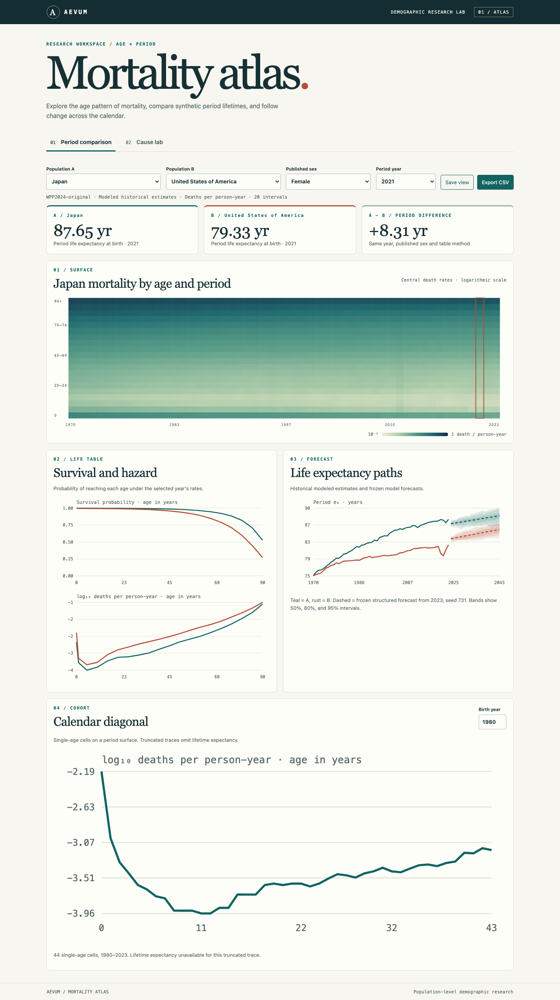

# Aevum

Aevum models age-specific mortality, constructs period and conditional cohort life tables, and compares population forecasts against historical outcomes. The local atlas connects UN World Population Prospects estimates, WHO registration counts, original demographic models, and a Rust life-table kernel.



## Run the demo

```sh
make bootstrap
make demo RUN_ID=first-demo
make verify EVIDENCE=evidence/first-demo-demo
```

The seeded demonstration derives 80.157 years of period life expectancy from 20 synthetic age intervals. The verifier recomputes the life table and checks that it rejects rehashed evidence with inconsistent survival, cause totals, units, or source status.

For the real-data dashboard, see [reproduction and setup](docs/REPRODUCING.md). The service runs locally, with Python 3.13, Rust 1.88+, and Node 24. The dashboard displays period survival, Lexis surfaces, historical cohort diagonals, frozen uncertainty paths, registration cause shares, conditional scenarios, and forecast scores when the associated evidence is loaded.

## Research

The historical panel covers 42 countries and 54 years for both published sex series. The UN values are modeled historical estimates, while the WHO analysis uses separate vital-registration tabulations. The rolling forecast matrix compares four baselines and two learned alternatives. The best baseline led at each tested horizon. Eight learned transfer comparisons performed worse than their untrained controls. See the [paper](docs/research/THESIS.md), [focused notes](docs/research/README.md), and [build status](docs/BUILD_STATUS.md).

- [Publication receipt and run-linked figures](docs/research/PUBLICATION.json)
- [Data and licensing](docs/DATA.md)
- [Architecture, diagrams, and walkthroughs](docs/ARCHITECTURE.md)
- [Demographic specification](docs/SPECIFICATION.md)
- [Experiment protocol](docs/EXPERIMENT_PLAN.md)
- [Architecture decisions](docs/adr/README.md)
- [Contribution guide](docs/CONTRIBUTING.md)
