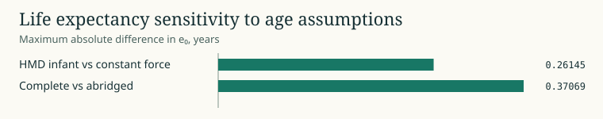

# Infant separation and old-age closure

In early infancy, deaths cluster near birth and can live substantially less of the first year than a constant-force schedule implies. The HMD v6 central-rate formula uses different breakpoints for the female and male series. We change only a(0) for the sensitivity and keep later closed intervals on constant force. The largest absolute e0 change is 0.261 years on the 4,536 WPP 2024 periods in the frozen 1970–2023 frame.

At the other end of the age schedule, an observed or modeled zero exposure gives no reliable terminal rate. The complete analysis excludes 194 periods, while 90+ pooled exposure supports all 4,536. Among 4,342 matched tables, the largest absolute complete-versus-abridged e0 difference is 0.371 years. Age resolution and terminal closure both change in this comparison. The separate bounded old-age fit is available for controlled plateau sensitivity. [Age-assumption evidence](CLAIMS.md) · [Old-age model](../../aevum/closure.py)

WPP 2024, 42 countries, 1970–2023, both sexes. Deaths per matched person-year. Deterministic maxima. [Plot data](figures/03-infant-tail.csv) · [Campaign and source receipts](PUBLICATION.json)
