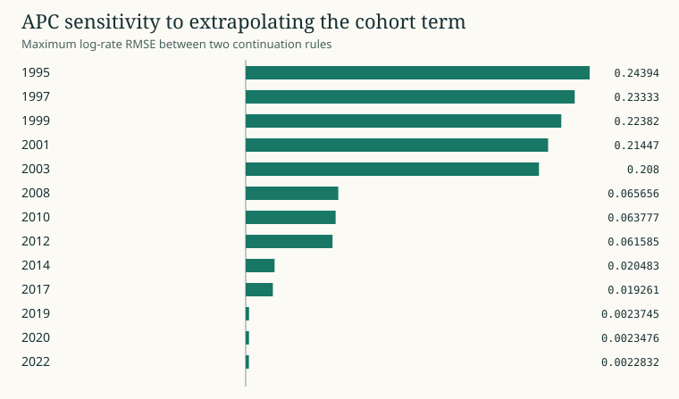

# APC extrapolation and the unidentified tilt

The Lexis identity period = age + cohort creates a linear null direction. Applying the same tilt with opposite signs to age and cohort and a positive sign to period leaves the sum unchanged. Aevum projects the cohort basis off the training intercept and period trend to document one fitted convention. Approximate birth cohort uses the age-band midpoint, which limits claims about narrow birth cohorts.

The 1,092 rolling population-specific APC fits on the WPP 2024 frame have a maximum tested null-direction error below 8 × 10⁻¹⁵ on the log-rate scale. Freezing the cohort feature beyond its support versus continuing it changes forecasts by as much as 0.244 log-rate RMSE for a fitted stratum. Both variants agree in the training window. That forecast difference expresses a boundary choice rather than sampling uncertainty. [Run evidence](CLAIMS.md)

WPP 2024 rolling origins, 42 countries, both sexes, 20 age bands. Model contrast across available forecasts. [Plot data](figures/06-apc.csv) · [Campaign and source receipts](PUBLICATION.json)
