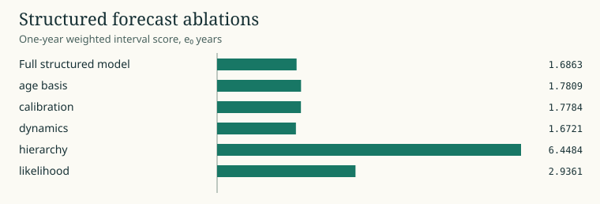

# Learned patterns and ablations

The structured time model uses a smooth age basis and country residuals shrunk toward a common sex schedule. Its time MLP caps nonlinear extrapolation at the forecast origin. The state-space alternative learns a recurrent transition with penalized in-window innovations. Both derive count means by combining rate and exposure, train from random initialization, and record optimizer and scheduler state.

The rolling WPP matrix contains 78 learned fits. Each improves held-out period e0 MAE against its own initial state. At one year the state-space average WIS is 1.559, compared with 0.343 for the coherent factor. Ablating country hierarchy raises structured one-year WIS to 6.45 across the matched 2003 and 2019 origins and three seeds. The result explains the importance of country variation within this architecture, while the full forecast comparison remains adverse. [Raw strata and ablation results](figures/strata.csv)

WPP 2024, 42 countries, both sexes, 20 age bands, deaths per person-year. Matched 2003 and 2019 origins across all seeds. [Plot data](figures/08-learned.csv) · [Campaign and source receipts](PUBLICATION.json)
