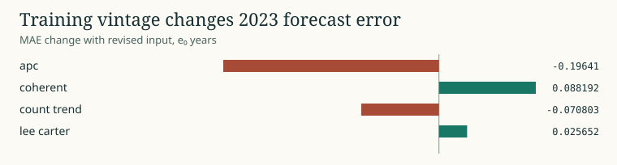

# What the release calendar changes

The 2022 archive supplies historical inputs through 2021 and was available in 2022. The 2024 archive revises those same years. The 2023 target in the latter archive is historical modeled mortality. We match source territory IDs, sex, exact age support and the overlap years before comparing or refitting. Projections from the older edition are excluded.

Across 4,368 periods in 42 countries and both sexes, absolute e0 revision has median 0.105 years. The maximum is 5.794 years for Bangladeshi males in 1999. For the 2023 outcome, APC MAE improves by 0.196 years with the revised input, while Lee-Carter MAE increases by 0.026. The availability-time forecast is a single historical release contrast with a two-year event-time gap. [Vintage run identities](CLAIMS.md) · [Availability diagram](../diagrams/vintages.svg)

42 countries, both sexes, 2023 target, historical cutoff 2021, age bands through 90+. Only the 2022 inputs were available at origin. [Plot data](figures/11-vintage.csv) · [Campaign and source receipts](PUBLICATION.json)
