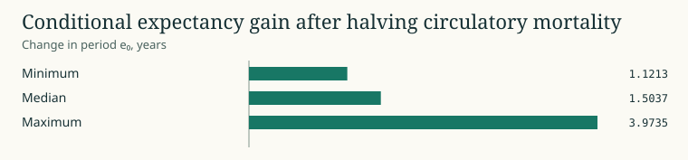

# Conditional competing risks

The scenario engine sums cause rates, applies a bounded multiplier to named causes and recomputes the life table. The residual and unknown categories remain in the total. The finite-change method averages forward and reverse age replacement. Within an age, it allocates change by the cause-rate differences times the same secant of conditional expectancy. A derivative limit handles canceling cause shifts at a fixed total.

The half-circulatory scenario was evaluated in 22 female/male population slices with matched 2019 WHO denominators and 24 age bins. Maximum reconciliation residual is 4.18 × 10⁻¹⁴ years. Across 278 paired sensitivity tables, smoothing adjacent midyear headcounts under an exponential interpolation changes e0 by a median absolute 0.00048 years. That comparison concerns smooth interpolation and does not measure differences due to reporting coverage or age transitions. [Scenario source](../../aevum/decomposition.py) · [Evidence and permissions](CLAIMS.md)

WHO February 2026 archive, 22 matched 2019 population-sex slices, 24 age bins. Approximate midyear denominators and fixed competing rates. [Plot data](figures/13-scenarios.csv) · [Campaign and source receipts](PUBLICATION.json)
