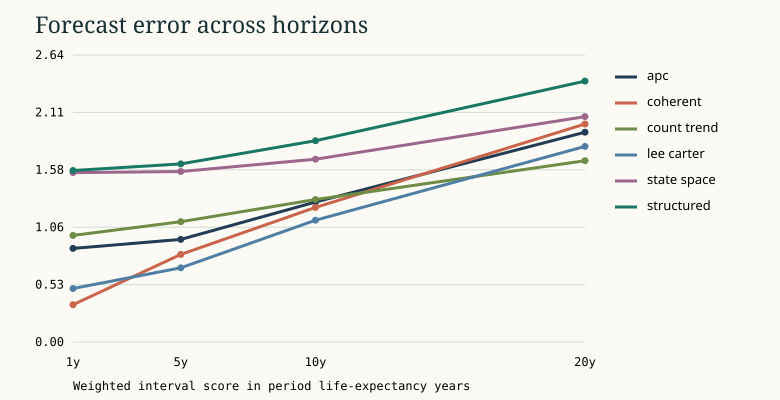
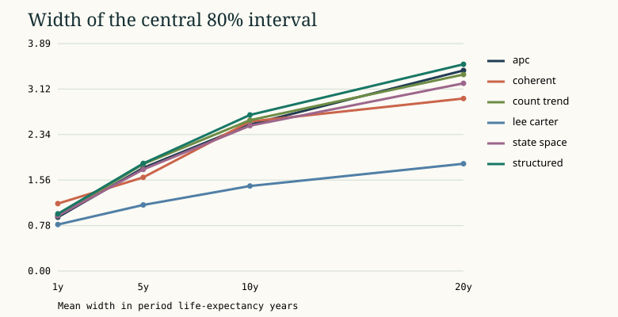

# Mortality surfaces under revision, drift, and shock

## Abstract

We compare demographic models that forecast age-specific death rates and derive period life expectancy from a life table. The historical frame contains 42 countries, both published sex series, and 54 calendar years in the original WPP 2024 release. The main comparison uses 13 rolling origins and four horizons. It includes four statistical baselines and two original learned models, with three training seeds for each learned rolling configuration. The best baseline has lower weighted interval score at each tested horizon. The two architectures improve over initialization in every rolling fit. Their transfers to some unseen countries and regions are worse than the corresponding initialization. Empirical coverage is below nominal in the modeled historical panel and deteriorates sharply during shocks. A separate WHO registration study shows substantial cause-composition errors after 2019, even under a source-quality screen.

## Identification and data

The estimand is a function of an age-specific mortality schedule. For a given period and source, central rates are the ratios of deaths to matched person-years. The life table represents the expectation under these rates applied to a synthetic cohort. Actual cohorts move across calendar periods. Their survival depends on the diagonal path of future as well as historical rates, and the open age group needs its own closure. A diagonal drawn through age-period cells approximates cohort exposure. Exact birth cohort inference would require deaths and exposures by Lexis triangle or other cohort-specific input.

The UN release supplies historical modeled deaths and compatible person-years. The latter reproduce the release's modeled mortality schedules by construction. Our retrospective backtests therefore score prediction of revised historical estimates. They exclude official projections and cannot identify accuracy against an unobserved, error-free registration outcome. We match territory codes within each release and use named geographic groups solely for evaluation and holdouts. The WHO analysis keeps its observed registration counts separate. It avoids joining those counts to a modeled WPP denominator.

The modeled panel contains 458,136 complete-key cells. Zero published exposure excludes 543 old-age cells from exact single-age rate fitting, with the youngest such cell at age 94. Exposure-weighted aggregation to 90+ preserves positive total exposure. The 20-interval forecast grid keeps infancy separate and pools ages 1–4, followed by standard five-year bands and the open 90+ interval.

## Methods

For a closed age interval of width n, fixed mean years lived a by those dying in the interval give q = n m / (1 + (n − a)m). The constant-force alternative integrates exp(−m t) on each interval. Both propagate entrants l and deaths d forward and total person-years T backward. The open age interval assumes constant positive m and closes at q = 1. The native implementation rejects inconsistent probabilities, invalid ages, and unsupported open tails. The WPP reproduction uses the published fixed a(x) inputs. The primary forecast endpoint uses constant force.

Lee-Carter uses the leading SVD component of age-centered log rates and a drifted random walk in the score. The Poisson trend baseline preserves zero counts and fits a log exposure offset. The age-period-cohort fit separates age levels and a period drift from residualized cohort curvature. It leaves the deterministic age-period-cohort linear identity unresolved by design. The coherent factor uses a shared same-sex reference and autoregressive country gaps. The two learned models combine age basis functions, sex curves, shrunk country effects and time dynamics. A time MLP caps its nonlinear extrapolation at the origin. A recurrent latent transition projects future states without fitted innovations after the cutoff.

Draws use synchronized historical residual increments in calendar blocks of three years. They include endpoint count and denominator perturbations and propagate through the same life-table semantics as point predictions. The denominator standard deviation is a sensitivity choice. It does not estimate UN source uncertainty. Seed results are separate. We report 50%, 80%, and 95% coverage, width, and interval score together with the median-weighted aggregate score. Country-block bootstrap comparisons group origins and both sexes within country. They cannot represent common regional or global shocks as independent observations.

## Results

### Forecast accuracy and calibration

| Horizon | Best baseline | Baseline WIS | Best learned WIS |
| --- | --- | ---: | ---: |
| 1 year | Coherent factor | 0.343 | 1.559 |
| 5 years | Lee-Carter | 0.682 | 1.569 |
| 10 years | Lee-Carter | 1.121 | 1.682 |
| 20 years | Count trend | 1.669 | 2.075 |

WIS units are period life-expectancy years. Differences between the best learned and best baseline are descriptive after selection within each horizon. The paired country-block interval for their difference is 0.86 to 1.63 years at one year and −0.20 to 1.02 at twenty years. The long-horizon estimate is compatible with either direction. Both learned families had nonzero parameter updates, with held-out improvement over random initialization in 78 of 78 rolling fits. Across all checkpoints, including diagnostic transfer and reused calibration configurations, improvement occurred in 127 of 135 comparisons. Training code can execute successfully while an out-of-support comparison deteriorates.

The coherent factor's nominal 80% interval covers 67.9% at one year, 35.4% at five years, and 25.7% at twenty. Mean interval width grows from 1.15 to 2.95 years across those horizons. The residual increments capture recent noise and some cross-age dependence but miss substantial drift and regime uncertainty. In one-year 2020–2021 targets, coherent point MAE is 1.14 years and 80% coverage is 31.0%. The corresponding other-year values are 0.40 years and 74.6%. That contrast mixes multiple origins and the populations that contribute to them. It should be interpreted as a conditional backtest diagnostic.

### Denominator, age and source effects

Replacing exposure-weighted pooling with an equal mean of single-age rates changes period expectancy by a median absolute 0.183 years. For Norwegian females between 1987 and 1988, the equal-weight computation indicates a 0.021-year improvement, while the compatible aggregated rates indicate a 0.011-year decline. The sign is fragile at this scale and sensitive to the age aggregation convention. It should not be interpreted as evidence of an isolated causal change.

The WPP table check reconstructed 249 eligible complete tables. Three schedules contain old-age central rates capped at 1 where the published probabilities differ from those implied by the displayed inputs. The published Lx field duplicates lx in the sampled export. The comparison retains the original columns and checks Lx as differences of published Tx. The largest absolute eligible expectancy difference at ages with at least one remaining synthetic survivor is 0.000052 years. This measures agreement under the same age assumptions and does not independently validate the source's fitted schedules.

WPP 2022 and WPP 2024 overlap in 4,368 aligned country-sex-year periods. Median absolute expectancy revision is 0.105 years and the maximum is 5.794 years for Bangladeshi males in 1999. At the 2023 endpoint, revising the training input vintages from 2022 to 2024 improves the retrospective APC MAE from 1.407 to 1.210 years, while Lee-Carter moves from 1.072 to 1.098. Only the 2022 release was available at the historical forecast date. Both predictions are evaluated against the later WPP 2024 estimate.

### Causes and competing risks

Twenty-one WHO country series have 15 comparable national ICD-10 years under the declared age-format, cause-coding, unknown-share and quality rules. The completeness evidence uses the latest WHO adult benchmark and an independent usability criterion. It does not measure each year or every age. The conditional composition study uses the 2014–2018 share forecast and the realized all-cause total for each test period. Mean absolute error in cause-share units is 0.0057 in 2019, 0.0242 in 2020 and 0.0304 in 2021. This comparison neither forecasts the total nor redistributes the residual.

For 22 eligible 2019 population-sex pairs, a half multiplier on circulatory mortality can be evaluated with explicitly approximate matched WHO denominators. The symmetric finite-change method averages age replacement in opposite orders and apportions the local effect to causes. The maximum reconciliation error is 4.18 × 10⁻¹⁴ years. This is a conditional mortality exercise. Interventions can alter other causes, competing risks, registration, and behavior.

### Known-truth results

The 200-panel synthetic study separates stable drift from an unannounced structural shock. Lee-Carter's five-year mean absolute expectancy error is 0.596 years in stable regimes and 3.677 under misspecification. Its central 80% interval covers 82.5% and 11.0%, respectively. The count trend performs better than Lee-Carter in shocked mean error at 3.321 years, but is worse in stable mean error and undercovers both regimes. Exposure offsets alone do not resolve age-specific extrapolation bias or generate calibrated forecast uncertainty.

## What the study does not identify

A recent historical release is subject to model smoothing and later source revisions. The single availability-time comparison isolates one change of training inputs but cannot establish forecast performance across several historical release environments. Long-run trends are conditional on the selected continuation assumptions. The age-period-cohort parameterization can move linear trends between the age, period, and cohort axes while preserving historical fitted rates. Extrapolation can then change with the chosen cohort boundary behavior. Registration completeness and cause compatibility vary within country and across ages. The cause cohort avoids known geographic incompatibilities but retains annual and age-specific quality uncertainty. None of the analysis identifies personal risk, intervention effects, or the period in which a real cohort will experience the forecast hazards.

## Reproduction

The [experiment protocol](../EXPERIMENT_PLAN.md) fixes population support, seeds, budgets, and endpoints. The [claim ledger](CLAIMS.md) identifies the underlying runs and figures. [Focused notes](README.md) provide the diagnostic evidence and constraints by mechanism.
